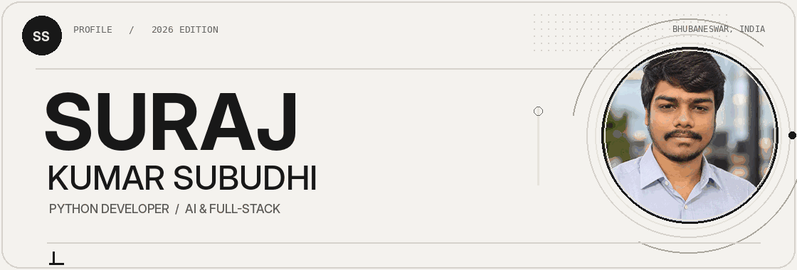
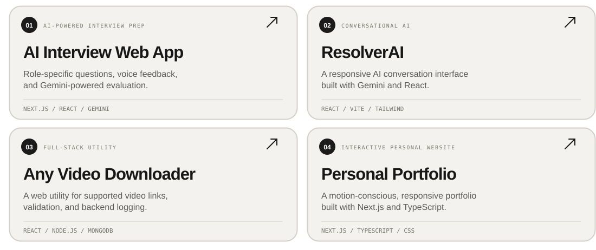
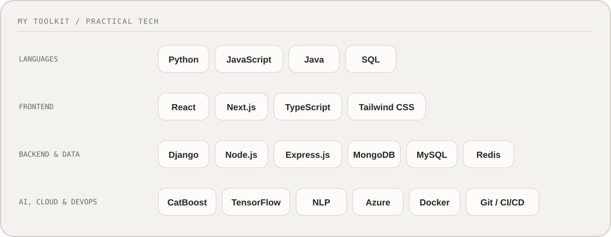
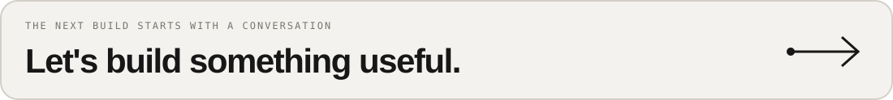

<!--
  SURAJ KUMAR SUBUDHI — GitHub Profile / Monochrome Edition
  Designed for GitHub's Markdown renderer: no scripts, injected CSS, or external image APIs.
  All artwork is hosted in ./assets so the README works without a separate website.
-->

<div align="center">
  <picture>
    <source srcset="./assets/hero.webp" type="image/webp" />
    
  </picture>
</div>

<br />

<div align="center">
  <a href="mailto:surajkumarsubudhi20@gmail.com"></a>&nbsp;
  <a href="https://www.linkedin.com/in/suraj-kumar-subudhi-23115a258/"></a>&nbsp;
  <a href="https://github.com/Suraj-0007/MyPortfolio/tree/master"></a>
</div>

<div align="center">
  <sub>PYTHON DEVELOPMENT &nbsp;·&nbsp; APPLIED AI &nbsp;·&nbsp; FULL-STACK ENGINEERING</sub>
</div>

<br />

## About

### Engineering practical intelligence.

I'm **Suraj Kumar Subudhi**, a **Python Developer at QuestionLab Inc** and an AI-focused full-stack developer based in **Bhubaneswar, Odisha, India**.

My work spans machine-learning pipelines, reliable backend APIs, data systems, and product interfaces. I enjoy taking a problem from **unclear requirements to useful, production-oriented software**.

Currently focused on **applied AI, system performance, and end-to-end product engineering**.

<details>
<summary><strong>My approach, in Python</strong></summary>

```python
class Suraj:
    role = "Python Developer"
    focus = ["Applied AI", "Backend Systems", "Full-Stack Apps"]

    def approach(self):
        return "Design. Build. Improve."
```

</details>

<sub>NOW — Permanent Python Developer, QuestionLab Inc &nbsp; | &nbsp; PREVIOUSLY — ML Intern, NSTL–DRDO</sub>

<br />

## Selected work

<sub>REAL APPLICATIONS &nbsp;/&nbsp; SELECTED PROJECTS</sub>

<div align="center">
  <picture>
    <source media="(max-width: 640px)" srcset="./assets/projects-mobile.svg" />
    
  </picture>
</div>

- [**AI Interview Web App**](https://ai-interview-app-gamma.vercel.app/) — adaptive, role-specific questions and AI-generated feedback with **Next.js, Gemini AI, Clerk, and Drizzle ORM**.
- [**ResolverAI**](https://resolver-ai.vercel.app/) — responsive AI conversation interface using **React, Vite, Tailwind CSS, and Gemini AI**.
- [**Any Video Downloader**](https://social-media-video-downloader-two.vercel.app/) — supported-link processing and backend logging with **React, Node.js, Express, and MongoDB**.
- [**Personal Portfolio**](https://github.com/Suraj-0007/MyPortfolio/tree/master) — interactive, responsive portfolio using **Next.js, React, TypeScript, and CSS**. [Explore the source](https://github.com/Suraj-0007/MyPortfolio/tree/master).

<br />

## The toolkit

<div align="center">
  <picture>
    <source media="(max-width: 640px)" srcset="./assets/stack-mobile.svg" />
    
  </picture>
</div>

**Backend and data:** Python · Django · REST APIs · Node.js · Express.js · MongoDB · MySQL · Redis  
**Interfaces:** React · Next.js · JavaScript · TypeScript · Tailwind CSS  
**AI and infrastructure:** Machine learning · CatBoost · TensorFlow · NLP · Azure · Docker · Git · CI/CD

<br />

## Experience and milestones

<blockquote>
<strong>FEB 2026 — PRESENT / PYTHON DEVELOPER · PERMANENT</strong><br />
QuestionLab Inc — applied machine learning, API development, AI-assisted business workflows, and React-based integrations.
</blockquote>

<blockquote>
<strong>OCT 2025 — FEB 2026 / PYTHON DEVELOPER · CONTRACTUAL</strong><br />
QuestionLab Inc — AI-enabled recruitment systems and Azure-integrated REST services.
</blockquote>

<blockquote>
<strong>DEC 2023 — JAN 2024 / MACHINE LEARNING INTERN</strong><br />
NSTL–DRDO — underwater-drag estimation and regression modeling.
</blockquote>

<blockquote>
<strong>2021 — 2025 / B.TECH, AI & DATA SCIENCE</strong><br />
C. V. Raman Global University · CGPA <strong>8.54/10</strong>.
</blockquote>

<details>
<summary><strong>Credentials and achievements — view details</strong></summary>
<br />

- **Microsoft Certified: Azure Data Scientist Associate (DP-100)** — score **881/1000**.
- **Microsoft Certified: Azure Fundamentals (AZ-900)** — score **952/1000**.
- **Naukri Campus Aptitude Test (NCAT)** — **All India Rank 178**, top **0.5%**.

</details>

<br />

## Find me

<div align="center">
  <a href="mailto:surajkumarsubudhi20@gmail.com"></a>
</div>

<p align="center">
  <a href="mailto:surajkumarsubudhi20@gmail.com"><strong>Email</strong></a>
  &nbsp; · &nbsp;
  <a href="https://www.linkedin.com/in/suraj-kumar-subudhi-23115a258/"><strong>LinkedIn</strong></a>
  &nbsp; · &nbsp;
  <a href="https://github.com/Suraj-0007/MyPortfolio/blob/master/public/resume.pdf"><strong>Résumé</strong></a>
</p>

<div align="center">
  <sub>INTENTIONAL DESIGN. PRACTICAL SOFTWARE. CONTINUOUS IMPROVEMENT.</sub>
</div>
